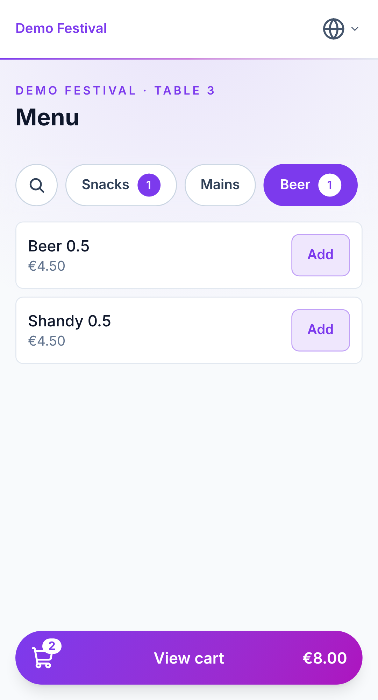
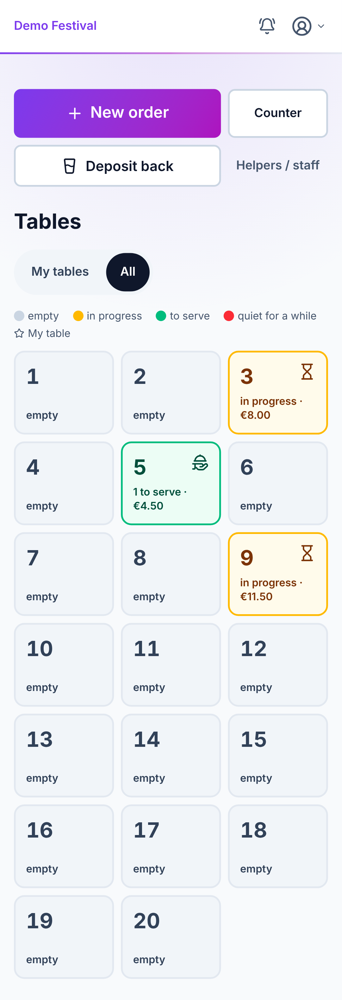
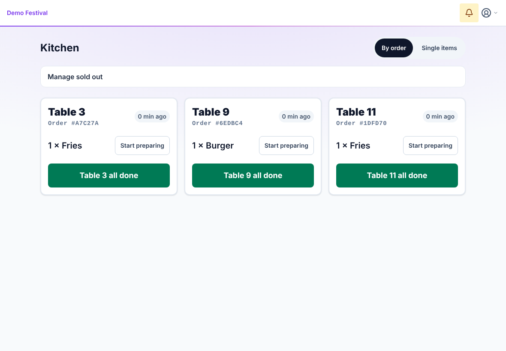

# Festival POS

Ordering and point-of-sale system for club and community festivals: guests order from their table via QR code, waiters collect cash at the table, kitchen and bar see their queues, and the admin manages the event, menu, QR codes and reports.

**Stack:** Nuxt 4 (Vue 3, Nitro) · Tailwind 4 / Nuxt UI · Pinia · nuxt-i18n (EN/DE) · PWA · Drizzle ORM · Postgres (Neon) · Vercel

The UI defaults to English. German stays selectable and is selected automatically for browsers that prefer German.

| Guest menu | Service: tables | Kitchen |
| --- | --- | --- |
|  |  |  |

Every screen also has a dark theme; more screenshots are in `docs/screenshots/overview/`.

## Running locally

Requirements: Node.js 22, pnpm 10 (`corepack enable`), a Postgres database (local, Docker or Neon).

```bash
pnpm install
cp .env.example .env          # fill in DATABASE_URL + JWT_SECRET
# With a local Postgres, also set: DB_DRIVER=pg
pnpm db:migrate               # create the schema
pnpm db:seed                  # demo event, menu, demo accounts (local only!)
pnpm dev                      # http://localhost:3000
```

Demo logins from `db:seed`: `admin` / `admin123` (password), `lead1` (shift lead), `waiter1`, `kitchen1`, `bar1` with PIN `1111`. Guest view: `http://localhost:3000/t/3`.

**Passkeys:** After a login with PIN or password, the app offers once per device to set up a passkey (not on the shared kitchen and bar tablets). Afterwards people sign in with fingerprint, face, device PIN or a password manager, without typing a username. Passkeys are managed under "Passkeys" (`/staff/passkeys`); admins can see and delete them in staff management. If an admin deletes a passkey (for example because a phone was lost), that person is signed out on all devices. Passkeys require HTTPS or `localhost`; an IP address such as `127.0.0.1` does not work.

## At the festival

- **Notes per item** ("no onions", max. 80 characters) from guests and waiters; kitchen and bar see them highlighted, and items with different notes are never merged.
- **Cash register and closing** per waiter (`/staff/cash`): opening float, expected = opening + collected − refunds paid out from this drawer − deposit returns (excluding rehearsal mode), counted amount and difference; all closings appear in the reports.
- **Deposit** per item, included when ordering; returns are handled at `/staff/deposit`; reported separately from revenue.
- **Stock** per item (optional): decremented atomically when ordering, sold out at 0, a cancellation gives it back. Kitchen and bar can mark items as sold out themselves.
- **Editing items later** (Event → Menu): click the price directly in the table, or use the pencil to edit name, price, deposit, category, station, stock, sort order and allergens, also after a spreadsheet import. Changes apply to new orders; booked items keep their name and price, and every change is written to the audit log.
- **Staff meals**: waiters book "Helper / staff" items at €0 with a reason; the report shows quantity and goods value, no revenue.
- **Promotional prices** (Event → "Promotions"): time-based prices such as "Happy Hour 5–6 pm beer €3" or "from 10 pm bratwurst €2" – a fixed price or a discount in % or €, for items and/or whole categories, optionally only on certain weekdays or dates, also across midnight (times in `Europe/Berlin`). The price is calculated server-side when ordering and stored on the item together with the promotion's name; deposit stays unchanged. If promotions overlap, the **lowest price** applies (no stacking), and on a tie the promotion that names the item individually wins; a promotion can only lower prices. Menu and waiter pad show the old price struck through with "Happy Hour until 18:00"; if the server books a different price than shown (a promotion started or ended), a notice shows the booked prices. The "Promotions" report shows quantity, revenue and discount per promotion.
- **Legal notice & privacy policy** per event (Admin → Design), shown as links at the bottom of the guest pages.
- **Print a receipt** after payment (not a tax receipt).
- **Tips**: when collecting payment, the waiter can tap "Change as tip" or "Round up" (to the next full euro, above €20 to the next €5) or enter any amount. Tips are not revenue; they stay in the cash drawer and count towards the expected amount, and the receipt and the "Tips" report per waiter show them, so they can be shared out after the festival.
- **End event**: the live event's workspace has its own button. It lists open tables, open cash drawers and finished items that were not served; the app makes open items visible but does not block. Another event can only be activated once the live one has ended. An ended event can be deleted permanently after exporting its reports as CSV.
- **Rehearsal mode** does not change stock levels, and cancellations in rehearsal mode give nothing back. "Delete test data" removes only test data. "End rehearsal" also resets table assignments and "asked at the table" marks, so the festival starts clean.
- **Confirmations** (closing the drawer, removing a passkey, renewing the join link) appear as the app's own dialog. Changing a PIN or password happens inline in the row under Admin → Staff.
- **Against orders from passers-by**: a guest phone stays signed in to its table for 12 hours; under "Hand out tables" the shift lead can also sign out all guest phones at the end of a shift ("Sign out guest phones"), after which guests scan the QR code on their table again. Each phone may have only so much ordered and not yet paid, separately for drinks (bar) and food (kitchen); the admin sets both amounts per event (Event → "Guest order limits", default €50 / €80, empty = no limit). The table bill shows which guest phone ordered a line ("Phone 2"). An item brought to a table where nobody ordered it is voided with the one-tap reason "Not ordered by this table"; the shift lead may void items that are already finished, and the voids report shows the table.
- **Call the service** (Event → Features, off by default): guests tap "Call the service" and pick a reason (pay, order, question). The table's waiter sees it at the top of the service screen with tone and vibration; if nobody holds the table or nobody answers within 2 minutes, every waiter sees it. The shift lead sees all calls with table, waiting time and waiter, and the bar screen shows every call, so waiters without a phone see it when they pick up drinks. "On my way" (or "Passed on" at the bar) answers the call, and the guest sees that someone is coming; a payment, a waiter's order or "asked" at the table answers it too. One open call per table, a new one at the earliest 2 minutes after the last. Switched off, the button and the lists are gone.
- **Buzzers at the kitchen/bar** (Event → Features, off until a key is set): up to two big buttons at the counter, each a one-key keyboard (USB or Bluetooth HID, e.g. a one-key macro pad or a DIY arcade button; cheap camera remotes that send "volume up" do not work in the browser). The admin taps "Set key" and presses the buzzer once. With a buzzer the kitchen and bar screen shows one lane per buzzer (1 green, 2 blue) instead of the cards: the order its person works on, with large items and the table number as a plate; the other orders wait below under "Next up". A press finishes the lane's order (toast with the table and "Undo") and the lane takes the oldest waiting order; the other lane keeps its order. Lanes are stored on the server, so every screen of a station shows the same, and a newly taken order counts as "in preparation" for the guest. In lane mode a later round of a table only joins its card when ordered within a minute of the card's first order; anything that arrives after the lane took the card shows apart as "New" on an amber line, so a changed quantity cannot slip by. A later round waits as its own card tagged "Later order". A tap finishes any order, lane or waiting, without moving the lanes. A second signal within a second is ignored, so a hard slap finishes one order; typing in a field is left alone. Test with any keyboard first.
- **Automatic retry when the network is busy**: ordering and collecting payment retry by themselves (after 1, 2, 4 and 8 seconds, at most 20 seconds in total). The button shows "attempt n of 4" and can be cancelled. If it is unclear whether a payment was booked, simply collect again: the same request is never booked twice.

## Environment variables

| Variable | Required | Purpose |
| --- | --- | --- |
| `DATABASE_URL` | yes | Postgres URL (Neon: *pooled* connection string) |
| `JWT_SECRET` | yes | ≥ 32 characters, signs the login cookies |
| `CRON_SECRET` | on Vercel | protects `/api/cron/sweep` (daily cleanup run, see DEPLOYMENT.md) |
| `COOKIE_DOMAIN` | no | leave empty unless you need a shared parent domain |
| `NUXT_PUBLIC_APP_URL` | no | fixed URL for QR codes and the join link (default: the address the admin opened the app on) |
| `WEBAUTHN_RP_ID` / `WEBAUTHN_ORIGIN` | no | domain and origin for passkeys (default: current domain), e.g. `pos.example.org` / `https://pos.example.org` |
| `DB_DRIVER` | no | `pg` = plain Postgres over TCP (local/CI); default is the Neon WebSocket driver |

Server values are read at runtime, not baked into the build. `/api/healthz` responds with 503 if something is missing.

## Scripts

| Command | What it does |
| --- | --- |
| `pnpm dev` / `pnpm build` / `pnpm start` | Development / build (migrates only on Vercel production or with `MIGRATE=1`) / start |
| `pnpm lint`, `pnpm lint:layers`, `pnpm typecheck` | ESLint, 300-line rule, types |
| `pnpm test` / `pnpm test:coverage` | Server: unit, contract and integration tests (pg-mem). App: stores, composables and components (happy-dom). Coverage thresholds per area |
| `pnpm test:pg` | Integration tests against a real Postgres (`TEST_DATABASE_URL`, completely rebuilt) |
| `pnpm test:e2e` | Playwright smoke tests against a running app (`PLAYWRIGHT_BASE_URL`, seeded DB) |
| `pnpm db:generate` / `pnpm db:migrate` | Generate a migration from `server/db/schema.ts` / apply migrations |
| `pnpm db:seed` | Demo data (refuses to run in production) |
| `pnpm admin:create` | Create an admin account or reset its password |
| `pnpm screenshots` | Screenshots of the scenes (light/dark) against a local Postgres, e.g. `--scene staff-grid --out docs/screenshots/<package>`; starts the app and database if needed |

## CI

`.github/workflows/ci.yml` runs on every PR and every push to `main`:

- **lint**, **typecheck**, **test** (with a coverage report in the job summary), **build** (as on Vercel)
- **db-e2e**: Postgres service → migrations from scratch → `test:pg` → seed → start the Node build → Playwright smoke tests for all flows (guest, waiter, kitchen/bar, admin, reports, refund, cash closing/receipt/staff meals/legal notice, PWA, CSP, axe accessibility)

`perf-smoke.yml` manually measures p95 latencies against a deployment URL. Dependabot keeps npm packages and Actions up to date.

## Deployment

See [DEPLOYMENT.md](DEPLOYMENT.md), which also covers backup and rollback.

## Legal notes

> **Not legal advice.** The following notes are the developers' assessment and do not replace advice from a tax advisor, the tax authority or a data protection officer. The organization that runs the app is responsible for its operation.

### Fiscal compliance (TSE)

This app is an ordering system, not a certified cash register. In some countries, electronic systems that record cash sales must meet fiscal requirements. In Germany, for example, § 146a AO (the fiscal code) and the KassenSichV (cash register security ordinance) apply to **electronic recording systems with a cash function**, and there is no exemption for non-profit clubs. The app records orders and books cash payments per waiter, so it is very likely such a system. It has **no** certified technical security module (TSE, *technische Sicherheitseinrichtung*), does not issue receipts that meet these requirements and is not registered with the tax authority.

Before the app books real money at an actual festival, there are two options:

1. **Run it as an ordering system only.** The app forwards orders to kitchen and bar and shows the open amount. Cash is settled separately through an **open cash box** with a cash report (opening float, closing balance, withdrawals, takings). The app's reports and cash closing are then internal aids only, not a cash record; the printed receipt is not a tax receipt. The cash and reports pages say so in a short note: "Internal control, not a tax-compliant cash closing".
2. **Ask a tax advisor first** whether and how the specific use (charitable or commercial activity, revenue level, type of cash register) is permitted.

### Data protection

The app is designed for data minimization (no guest accounts, no tracking, no analytics). Even so, it processes personal data, and the operator needs a legal notice and a privacy policy. The admin enters the texts per event under "Design"; the app shows them as links on the guest pages but does not prescribe their content.

- **Cookies:** Technically necessary cookies that do not require consent (in Germany § 25 para. 2 TDDDG, the implementation of the ePrivacy rules): guest session (HttpOnly, 12 hours, links orders to the table), staff login (HttpOnly, 12 hours), CSRF protection, and `pos_theme` (light/dark setting). The view selection in kitchen/bar is stored in the device's `localStorage`.
- **Stored data:** Orders and payments with table number and waiter, audit log (who collected, cancelled or refunded, and when), staff accounts (username, hash of password/PIN; for join-link users only the name they entered, bound to one event). Failed logins store the username and IP address for 15 minutes.
- **Logs:** Vercel logs requests (including IP address, URL and user agent) according to its own retention periods. The app writes JSON logs with request ID, route, staff ID, table number and amounts, but without IP addresses or order contents.
- **Data processors:** **Vercel** (hosting, logs) and **Neon** (database). A data processing agreement (DPA, in the EU under Art. 28 GDPR; German "AVV") is required with both. Both offer standard DPAs. Region: Frankfurt (`fra1`, AWS `eu-central-1`); Vercel and Neon are US companies, so transfers rely on their standard contractual clauses or the EU-US Data Privacy Framework.
- **Deletion:** A daily sweep deletes guest sessions without orders, payment locks and old login attempts. Orders, payments, refunds, cash closings and the audit log are kept for accounting (rule in `.specify/memory/constitution.md`, principle IV). There is not yet a tool to delete old events together with their orders.

## More documentation

- [`AGENTS.md`](AGENTS.md): short rules for AI agents and contributors
- [`specs/001-festival-pos-third-variant/`](specs/001-festival-pos-third-variant/spec.md): the current specification, with a section "Added since the spec"
- [`specs/002-kellner-bestellung-tischansicht/`](specs/002-kellner-bestellung-tischansicht/plan.md): waiter ordering and table view

## License

[MIT](LICENSE)
